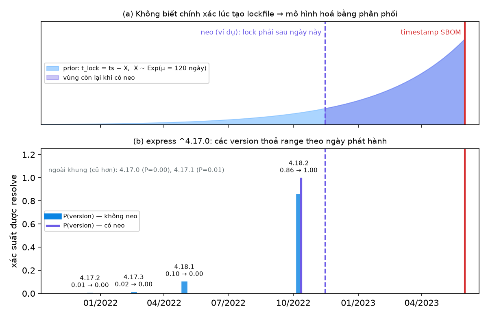

# Cơ sở đề xuất phương pháp VERA

*Tài liệu bổ trợ cho [bao_cao.md](bao_cao.md): cơ sở lý thuyết và thực nghiệm của từng thành phần trong VERA.*

> **Lưu ý về số liệu.** Các con số trong tài liệu này lấy từ **tập dev** (25% repo, chỉ dùng để tinh chỉnh) hoặc từ các
> **lần chạy thử minh hoạ** trong quá trình phát triển. Số liệu chính thức (tập test, ablation, đường cong ngân sách RQ5)
> nằm trong báo cáo chính sau khi thí nghiệm chạy xong; khi trích dẫn kết quả nên dùng số của tập test.

---

## 1. Nguyên tắc chung

Mỗi thành phần của VERA dựa trên ba cơ sở:

1. **Hành vi đã có trong tài liệu chính thức** của package manager (npm, uv/pip, Maven) và của chuẩn dữ liệu lỗ hổng (OSV).
   Phương pháp chỉ *viết lại chính xác* hành vi đó để tính toán được.
2. **Quan sát thực nghiệm trên tập dev**: những chỗ bắt buộc phải giả định (2 tham số μ và w) đều được ước lượng trên tập
   dev tách riêng, không đụng tới tập test.
3. **Kiểm chứng bằng ablation**: bỏ từng thành phần rồi đo xem kết quả giảm bao nhiêu trên tập test.

Phần toán thực chất chỉ nói một ý: *package manager chọn version cao nhất thoả range tại thời điểm cài; ta không biết
chính xác thời điểm đó nên tính xác suất cho từng version.*

---

## 2. Bảng tổng quan

| Thành phần | Ý tưởng một câu | Cơ sở | Bằng chứng trong dự án | Giả định / giới hạn |
|---|---|---|---|---|
| Temporal resolver model | Range → xác suất cho từng version, theo thời điểm lock | Package manager chọn version cao nhất thoả range; npm `--before`, uv `--exclude-newer` | Dev: vuln F1 ký hiệu vượt heuristic (bảng §3.1) | Thời điểm lock theo phân phối mũ |
| Neo từ cận dưới khai báo | Cận dưới của range cho biết lock được tạo *sau* ngày nào | npm ghi `^version`; `uv add` ghi `>=version` | Neo cứng: npm tăng, PyPI giảm → mô hình hỗn hợp | Trọng số w học trên dev |
| Ràng buộc chéo | Version phải thoả *mọi* requirement cùng lúc | Định nghĩa dependency resolution (PubGrub trong uv) | Ablation `noCo` | Chỉ dùng requirement của component đã biết version |
| Khôi phục transitive | Dựng lại cây phụ thuộc rồi resolve lại tại thời điểm SBOM | Dữ liệu đồ thị deps.dev; Maven "nearest wins" | Ablation `noGraph` | deps.dev có thể thiếu / lệch môi trường |
| Dấu vân tay OS | Version đang cài trùng version "fixed" của bản phát hành nào | Schema OSV: sự kiện `fixed` là version thật của bản phát hành đó | ghost:5.71‑alpine: Alpine 3.17 đúng, 4 trùng khớp so với 0 | Chỉ chấp nhận khi có người thắng rõ ràng |
| VUG | Chỉ tốn công ở chỗ có thể đổi kết luận lỗ hổng | Lý thuyết giá trị thông tin; CVSS | Đường cong ngân sách RQ5 | Giá trị tính trên snapshot OSV |
| Verifier | LLM đề xuất, registry kiểm chứng | LLM bịa ~19,7% tên package (Spracklen et al.) | Hallucination B3/B4 so với VERA | Không kiểm chứng được gói OS bằng registry |
| Báo cáo xác suất | Giữ lại độ bất định thay vì ép thành có/không | VEX `under_investigation`; Brier score | Biểu đồ hiệu chỉnh | Phụ thuộc chất lượng phân phối version |

---

## 3. Chi tiết từng thành phần

### 3.1 Temporal resolver model

**Trực giác.** Manifest ghi `express ^4.17.0`. Không có lockfile nên không biết version thật. Nhưng ta biết:
(1) npm luôn cài **version cao nhất thoả `^4.17.0` có sẵn lúc cài**; (2) lockfile được tạo **trước** timestamp của SBOM.
Vậy nếu biết lúc cài thì biết chính xác version. Ta không biết lúc cài, nên tính xác suất.



*Hình: express `^4.17.0`, SBOM tạo ngày 2023‑06‑01 (dữ liệu registry thật, sinh bằng
[`img/make_temporal_figure.py`](img/make_temporal_figure.py)). Không có neo: 4.18.2 có xác suất 0,86, 4.18.1 có 0,10.
Với một mốc neo minh hoạ (lock phải sau 15/11/2022), chỉ còn 4.18.2.*

**Cơ sở.**
- npm và uv mặc định chọn version cao nhất thoả mãn ràng buộc (node‑semver `maxSatisfying`; uv mặc định
  `--resolution highest`).
- Bản thân các package manager thừa nhận kết quả resolve phụ thuộc vào thời điểm: npm có cờ `--before` ("chỉ cài các
  version có sẵn vào hoặc trước thời điểm `--before`"), uv có `--exclude-newer`. Baseline B2 dùng đúng các cờ này.
- **Điểm mới:** B2 giả định biết chính xác thời điểm lock. VERA coi thời điểm đó là bất định và tính phân phối, nên trả
  về được *độ tin cậy* cho từng version thay vì một đáp án duy nhất.

**Vì sao chọn phân phối mũ cho X = ts − t_lock?**
- X là đại lượng dương, và ta chỉ có một thông tin là giá trị trung bình μ. Khi đó phân phối có entropy cực đại (ít giả
  định thêm nhất) là phân phối mũ (Jaynes, 1957).
- μ không tự đặt mà quét lưới trên tập dev:

| μ (ngày) | 30 | 60 | 120 | 240 |
|---|---|---|---|---|
| npm, vuln F1 (w = 0,5) | 0,586 | 0,598 | **0,620** | 0,623 |
| PyPI, vuln F1 (w = 0) | 0,300 | **0,524** | 0,502 | 0,398 |

- **Hạn chế:** npm ít nhạy theo μ; PyPI nhạy hơn (μ quá nhỏ cho kết quả kém). Thay phân phối mũ bằng
  phân phối thực nghiệm học từ dữ liệu là hướng phát triển.

**Bằng chứng ban đầu (tập dev, chỉ phần ký hiệu, chưa có neo).** Vuln F1: npm 0,19 (heuristic B1‑ts) so với 0,49
(VERA‑noLLM); PyPI 0,27 so với 0,50; Maven 0,50 so với 1,00.

### 3.2 Neo thời gian từ cận dưới khai báo và mô hình hỗn hợp

**Trực giác.** Nếu manifest ghi `^4.18.2` thì lúc tạo lock, version 4.18.2 *phải* đã tồn tại. Lấy cận dưới của tất cả
các range thì được một mốc: *lock được tạo sau ngày phát hành muộn nhất trong các cận dưới đó.*

**Cơ sở (tài liệu chính thức).**
- npm: `save-prefix` mặc định là `^`, tức `npm install x` ghi `^<version vừa cài>` vào package.json.
- uv: `uv add` thêm ràng buộc dạng `>=<version mới nhất tương thích>`.
- Vì vậy cận dưới gần như chính là "version tại thời điểm thêm phụ thuộc". Đây là ràng buộc logic chứ không phải giả định.

**Quá trình dẫn tới mô hình hỗn hợp (phương pháp được dẫn dắt bởi dữ liệu).**
- Phiên bản đầu dùng **neo cứng**. Trên tập dev (μ = 120): npm tăng 0,49 → 0,62, nhưng PyPI **giảm** 0,50 → 0,33.
- Nguyên nhân nằm trong tài liệu uv: *"uv will prefer the previously locked versions… Package versions will only change
  if the project's dependency constraints exclude the previous, locked version."* npm cũng giữ version trong
  `package-lock.json`. Tức lockfile là **hỗn hợp nhiều thời điểm**: gói thêm sau được resolve muộn, gói cũ giữ version cũ.
- Do đó VERA dùng phân phối hỗn hợp `P = w·P_neo + (1 − w)·P_không‑neo`, với w học trên dev: npm w = 0,5, PyPI w = 0.
  Kết quả khớp với hành vi đã quan sát: lockfile Python gần như không được làm mới đồng loạt.

### 3.3 Ràng buộc chéo

**Trực giác.** Nếu `react-dom@18.2.0` yêu cầu `react ^18.2.0` thì `react` phải thoả cả range của chính nó lẫn yêu cầu
này.

**Cơ sở.** Đây chính là định nghĩa của bài toán resolve phụ thuộc: version được chọn phải thoả *mọi* requirement cùng
lúc. Các resolver thật làm đúng như vậy (uv dùng thuật toán PubGrub). VERA chỉ lấy giao các ràng buộc rồi tính lại phân
phối.

### 3.4 Khôi phục transitive

**Trực giác.** SBOM chỉ ghi phụ thuộc trực tiếp thì thiếu phần lớn phụ thuộc bắc cầu, mà đó là nơi có nhiều lỗ hổng.

**Cơ sở.**
- Cạnh và requirement của đồ thị phụ thuộc lấy từ deps.dev (Google Open Source Insights).
- deps.dev resolve tại thời điểm *nó* thu thập dữ liệu, không phải thời điểm của SBOM, nên VERA resolve lại từng node
  bằng temporal model tại timestamp của SBOM.
- Maven chọn version theo quy tắc "nearest definition" (gần gốc nhất thắng) trong tài liệu cơ chế phụ thuộc của Maven;
  `${property}` và `dependencyManagement` được giải qua chuỗi parent pom.
- Lựa chọn ground truth từ lockfile được củng cố bởi Zhou et al. (arXiv 2511.20313): lockfile cùng package manager mạnh
  cho SBOM chính xác và nhất quán. Khi không có lockfile, Syft/Trivy chỉ resolve phụ thuộc trực tiếp có version cố định.

### 3.5 Dấu vân tay bản phát hành hệ điều hành

**Trực giác.** Gói `apk`/`deb` thiếu thông tin distro thì scanner không biết tra cơ sở dữ liệu của bản phát hành nào,
nên bỏ qua toàn bộ lỗ hổng OS. Nhưng version của gói đã "tố cáo" bản phát hành.

**Cơ sở.** Theo schema OSV, sự kiện `fixed` trong advisory của Alpine 3.17 là version thật được phát hành cho
Alpine 3.17. Nếu nhiều gói đang cài có version trùng nguyên văn với version của một bản phát hành thì đó là bằng chứng
(cùng ý tưởng với fingerprinting hệ điều hành). Ngưỡng chấp nhận đặt chặt: ít nhất 3 trùng khớp và gấp đôi bản phát hành
đứng thứ hai.

**Ví dụ.**
- ghost:5.71.0‑alpine: dấu vân tay chọn Alpine 3.17 (4 trùng khớp so với 0), đúng.
- Debian được nhận diện qua version của gói `base-files` (ví dụ `12.x` → Debian 12).
- redis:7.0.12‑alpine3.18 (lần chạy thử, mức suy giảm nặng): dấu vân tay không đủ rõ, LLM xác định đúng Alpine 3.18;
  vuln F1 tăng từ 0 lên 1,0.
- nginx:1.24.0‑alpine: LLM đoán Alpine 3.18, thực tế là 3.17. Dấu vân tay ở ca này không đủ mạnh để bác, nên lỗi lọt
  qua. **Đây là giới hạn cần nêu:** quyền phủ quyết của dấu vân tay chỉ hiệu lực khi nó có người thắng rõ ràng.

### 3.6 VUG — ưu tiên theo bất định lỗ hổng

**Trực giác.** Gọi LLM tốn thời gian và tiền. Component nào *dù chọn version nào cũng có cùng danh sách lỗ hổng* thì
không cần hỏi thêm. Ưu tiên những chỗ mà chọn sai sẽ báo sai lỗ hổng nghiêm trọng.

**Cơ sở.**
- Lý thuyết giá trị thông tin (Howard, 1966): chỉ thu thập thêm thông tin khi nó có thể thay đổi quyết định. Ý tưởng
  tương tự có trong active learning.
- Mức nghiêm trọng lấy theo chuẩn CVSS từ dữ liệu OSV.
- **Bằng chứng:** đường cong "vuln F1 theo ngân sách" của VUG so với thứ tự FIFO (RQ5, xem báo cáo chính).

### 3.7 Verifier cho agent LLM

**Trực giác.** LLM giỏi đoán *tên* (vd. `jackson-databind` thuộc groupId `com.fasterxml.jackson.core`) nhưng có thể bịa.
Vì vậy LLM chỉ được *đề xuất*, còn registry *quyết định*.

**Cơ sở.**
- Spracklen et al. (USENIX Security 2025): trên 576.000 mẫu code từ 16 LLM, **19,7%** package được gợi ý là không tồn tại.
- Mô hình "suy luận + gọi công cụ + dựa trên bằng chứng" theo ReAct (Yao et al., ICLR 2023).
- Verifier kiểm tra: package tồn tại, version tồn tại, thoả range khai báo, phát hành trước timestamp của SBOM, và có
  trích dẫn mã bằng chứng hợp lệ.

**Bằng chứng trong dự án.**
- Lần chạy thử trên 1 repo PyPI (Qwen3.6‑35B, trước khi tắt chế độ thinking): hallucination 14% với B3 (zero‑shot) và
  7% với B4 (ReAct không verifier).
- Maven zookeeper 3.9.0 suy giảm nặng (lần chạy thử): vuln F1 0,07 (SBOM lỗi) → 0,87 (chỉ ký hiệu) → 0,95 (có agent).
  Agent khôi phục đúng groupId `io.netty`, `org.eclipse.jetty`, tất cả qua verifier.
- Số tổng hợp: cột `hallucination` và ablation `noVerifier` trong báo cáo chính.

### 3.8 Báo cáo lỗ hổng xác suất

**Trực giác.** Thiếu thông tin version mà vẫn báo có/không thì hoặc bỏ sót, hoặc báo tràn lan. Giữ xác suất cho phép
phân tầng: *confirmed* (≥ 0,95), *likely* (≥ 0,5), *possible* (< 0,5, cần người xem).

**Cơ sở.**
- Tầng *possible* tương ứng trạng thái **Under Investigation** trong yêu cầu tối thiểu cho VEX của CISA.
- Chất lượng xác suất đo bằng Brier score, một quy tắc chấm điểm "proper" (Brier, 1950; Gneiting & Raftery, 2007), và
  biểu đồ hiệu chỉnh (xác suất dự đoán so với tỉ lệ đúng thực tế).

---

## 4. Phụ lục: công thức

**Temporal resolver model.** Gọi `v_1, …, v_n` là các version thoả range, sắp theo ngày phát hành `p_1 < … < p_n ≤ ts`.
Trong khoảng `[p_i, p_{i+1})` (với `p_{n+1} = ts`), package manager chọn `r_i = max_{j ≤ i} v_j` (max theo thứ tự version,
xử lý được trường hợp backport). Với `X = ts − t_lock ~ Exp(μ)`:

```
P(v) ∝ Σ_{i : r_i = v} [ exp(−(ts − p_{i+1})/μ) − exp(−(ts − p_i)/μ) ]
```

**Neo và mô hình hỗn hợp.** Với `t_floor = max_k pub(min version thoả range_k)`, `P_neo` tính như trên nhưng cắt mỗi khoảng
về `[max(p_i, t_floor), p_{i+1})`. Phân phối dùng: `P = w·P_neo + (1 − w)·P_không‑neo`.

**Giá trị VUG.**
- Task version: `D(c) = Σ_v P(v) · sev( V(v) Δ V(mode) )`, với `V(v)` là tập lỗ hổng của version v và Δ là hiệu đối xứng.
- Task định danh: `M(c) = Σ_{a ∈ OSV(name)} sev(a)`.
- Ưu tiên = giá trị / chi phí; task có giá trị 0 được đẩy xuống cuối.

**Xác suất lỗ hổng và Brier score.**
`P(vuln) = Σ_v P(v) · 1[v bị ảnh hưởng]`;  `Brier = (1/N) Σ (P_k − y_k)²`, với y_k = 1 nếu cặp component–lỗ hổng có trong
ground truth.

---

## 5. Tài liệu tham khảo

**Tài liệu chính thức của công cụ**
- npm config: `save-prefix` (mặc định `^`), `before` — <https://docs.npmjs.com/cli/v10/using-npm/config>
- npm `package-lock.json` — <https://docs.npmjs.com/cli/v10/configuring-npm/package-lock-json>
- uv: `uv add` thêm ràng buộc `>=` — <https://docs.astral.sh/uv/concepts/projects/dependencies/>
- uv: ưu tiên version đã lock — <https://docs.astral.sh/uv/concepts/projects/sync/>
- uv: chiến lược resolve, PubGrub — <https://docs.astral.sh/uv/concepts/resolution/>
- Maven: dependency mediation ("nearest definition") — <https://maven.apache.org/guides/introduction/introduction-to-dependency-mechanism.html>
- OSV schema — <https://ossf.github.io/osv-schema/>
- deps.dev API v3 — <https://docs.deps.dev/api/v3/>
- CISA, *Minimum Requirements for Vulnerability Exploitability eXchange (VEX)* — <https://www.cisa.gov/resources-tools/resources/minimum-requirements-vulnerability-exploitability-exchange-vex>

**Nghiên cứu**
- J. Spracklen et al., *We Have a Package for You! A Comprehensive Analysis of Package Hallucinations by Code Generating
  LLMs*, USENIX Security 2025 — <https://www.usenix.org/conference/usenixsecurity25/presentation/spracklen>
- L. Zhou, M. Dacier, C. Konstantinou, *A Reality Check on SBOM-based Vulnerability Management*, arXiv 2511.20313 —
  <https://arxiv.org/abs/2511.20313>
- Y. Gamage et al., *Software Bills of Materials in Maven Central*, MSR 2025 — <https://arxiv.org/abs/2501.13832>
- E. O'Donoghue et al., *Impacts of SBOM Generation on Vulnerability Detection*, SCORED 2024
- S. Yao et al., *ReAct: Synergizing Reasoning and Acting in Language Models*, ICLR 2023
- R. A. Howard, *Information Value Theory*, IEEE Trans. Systems Science and Cybernetics 2(1), 1966
- E. T. Jaynes, *Information Theory and Statistical Mechanics*, Physical Review 106(4), 1957
- G. W. Brier, *Verification of Forecasts Expressed in Terms of Probability*, Monthly Weather Review 78(1), 1950
- T. Gneiting, A. E. Raftery, *Strictly Proper Scoring Rules, Prediction, and Estimation*, JASA 102(477), 2007
